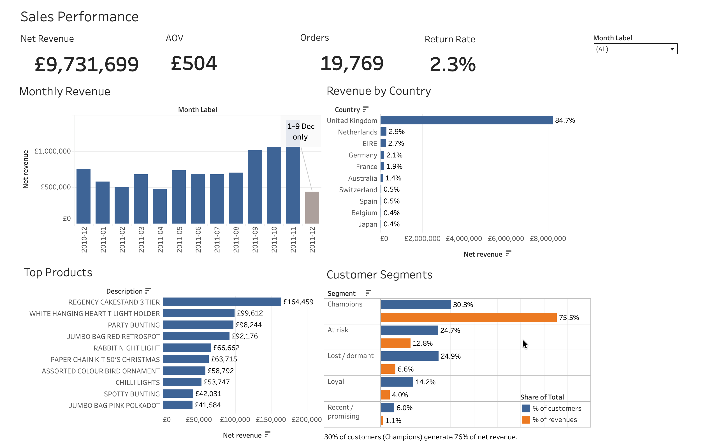
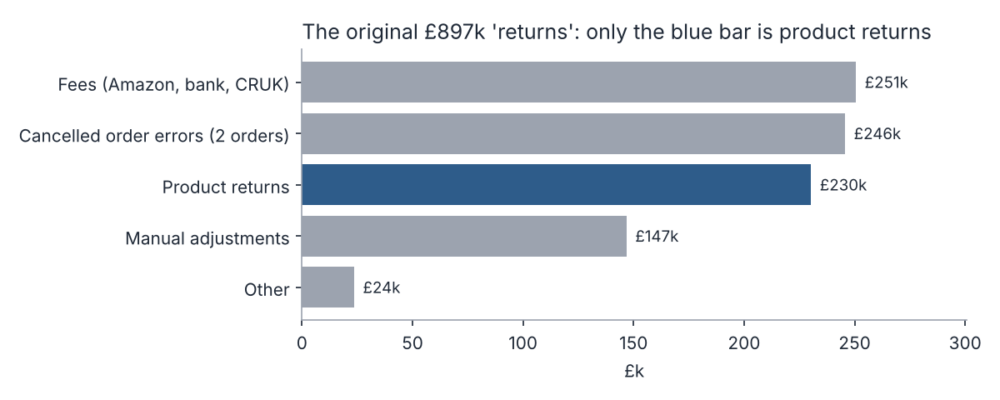
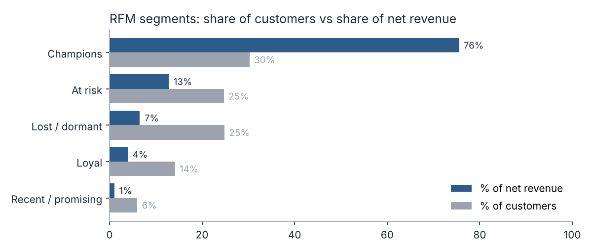
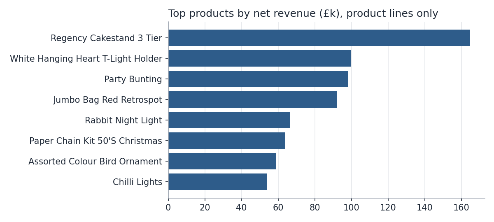

# Retail Sales & Customer Analytics

Business analysis and data project on the UCI **Online Retail** dataset: 541,909 transaction lines from a
UK online giftware retailer, December 2010 to December 2011. It covers the business-analysis cycle
(current-state assessment, requirements, process maps, gap analysis) and the data work (data-quality
review, cleaning rules, star-schema model, RFM segmentation and a Tableau dashboard).

**Live dashboard:** [Tableau Public: Sales Performance](https://public.tableau.com/app/profile/yash.dubey7502/viz/Retail-BA/SalesPerformance)



## Key findings

- **Net product revenue was £9.73m** (£9.96m gross product sales less £230k returns) across 19,769
  orders, with an average order value of £504.
- **The real product return rate is 2.3%, not 8.4%.** Only £230k of the £897k recorded on cancellation
  invoices was product returns (see below).
- **Revenue is concentrated:** Champions (30% of identified customers) generate **76%** of net revenue,
  and the UK accounts for 84.7%.
- **Strong Q4 seasonality:** net revenue rose from £0.50m in February to £1.43m in November 2011.
- **15.2% of product sales have no CustomerID**, so customer-level results describe the other 84.8%.

## What the data-quality review found

Cancellation invoices (`C` prefix) are usually treated as returns. Classifying every line showed they
mix four different things:



- **Fees (£251k)** and **manual adjustments (£147k)** are accounting entries, not products.
- **Two cancelled order errors (£246k):** 80,995 units of *Paper Craft, Little Birdie* (£168k) and
  74,215 units of *Medium Ceramic Top Storage Jar* (£77k), each reversed in full within minutes. Left in,
  they also appear as the #2 and #6 best-selling products and give one customer £77k of "spend".

Every raw row gets exactly one classification, applied in order (`analysis/cleaning.py`):

| Line type | Rows | Rule |
| --- | --- | --- |
| Product sale | 522,533 | Everything not caught by a rule below |
| Product return | 8,666 | Cancellation lines for real products |
| Non-product | 2,924 | Postage, carriage, fees, manual adjustments, discounts, samples, gift vouchers |
| Duplicate | 5,268 | Exact copy of an earlier row (assumed double-load) |
| Stock adjustment | 1,336 | Quantity ≤ 0 on a normal invoice, priced £0 ("damaged", "check") |
| Invalid price | 1,176 | Unit price ≤ 0 |
| Order error | 4 | Sale ≥ £10,000 fully reversed by the same customer within 24 hours, and its cancellation |
| Price error | 2 | Priced over 50× the product's median (a £649.50 picnic basket whose median price is £5.95) |

Revenue metrics use product sales and product returns only. Full results, including the independent
data-quality checks and monthly figures, are in [`docs/findings.md`](docs/findings.md).

## Customers and products



RFM spend is **net of returns**. Monetary based on gross sales would have counted the £77k ceramic-jar order
as a customer's spend, even though it was cancelled 16 minutes later.



## Repository

| Path | What it is |
| --- | --- |
| `analysis/cleaning.py` | Shared loading, data-quality checks and line classification (single source of rules) |
| `analysis/00_download_data.py` | Downloads the dataset |
| `analysis/01_profile_and_analyse.py` | Profiling, KPIs, RFM; writes `docs/findings.md` |
| `analysis/02_figures.py` | Charts in `figures/` |
| `analysis/03_build_dashboard_dataset.py` | One file for Tableau or Power BI, every row tagged with its line type |
| `analysis/04_build_snowflake_bundle.py` | Dimension and fact files for the star schema (`snowflake-bundle/`) |
| `tests/test_cleaning.py` | One test row per classification rule |
| `docs/BRD.md`, `docs/RTM.md` | Business requirements and traceability matrix |
| `docs/process_maps.md` | As-is and to-be process maps, gap analysis |
| `docs/snowflake_star_schema.sql` | Star schema (Snowflake), with reconciliation queries |
| `docs/dashboard_spec.md` | Dashboard build spec, with Tableau and Power BI (DAX) calculations |

## How to reproduce

```bash
pip install -r requirements.txt
python analysis/00_download_data.py
python analysis/01_profile_and_analyse.py
python analysis/02_figures.py
python analysis/03_build_dashboard_dataset.py
python analysis/04_build_snowflake_bundle.py
pytest
```

## Version history

**v2 (Nov 2026):** reclassified cancellation invoices, separated non-product lines, and excluded two order
errors and two price errors. This corrected the return rate (8.4% → 2.3%), the revenue base (£10.64m gross
including fees → £9.73m net product revenue) and the top-products list, and made RFM spend net of returns.
All cleaning rules now live in one module with tests.

## Skills demonstrated

Data-quality assessment and root-cause analysis · cleaning rule design · business analysis (BRD, RTM,
process mapping, gap analysis) · dimensional modelling (Snowflake) · RFM segmentation · Python (pandas,
matplotlib, pytest) · Tableau dashboard design.

## Data

[UCI Online Retail dataset](https://archive.ics.uci.edu/dataset/352/online+retail) (Daqing Chen, 2015),
downloaded from a public mirror. See the UCI page for licence terms.
