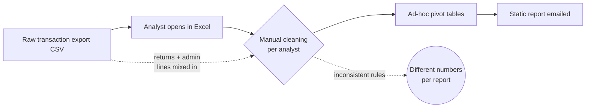
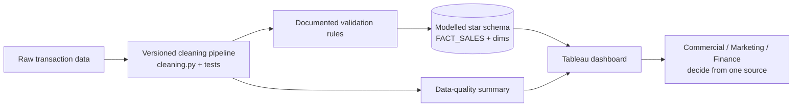

# Process Maps — Data-to-Insight Workflow

> Two views: the **current (as-is)** manual process and the **future (to-be)** modelled process this project delivers. The Mermaid blocks render on GitHub automatically.

## L1 — Process context (one line)
Raw online-order data → cleaned & modelled → reported, so commercial and marketing teams decide from one source of truth.

## L2 — Current state (as-is)

**Pain points (evidence-tagged):**
- Cleaning rules differ per analyst → numbers don't reconcile (NFR2, NFR3).
- Returns and postage/admin lines not separated → inflated/!=net figures (P2, P3).
- 24.9% of rows have no customer → customer analysis quietly incomplete (P1).
- No data-quality visibility → issues persist unnoticed (P6/BR6).

## L3 — Future state (to-be)

**What changes:** cleaning is codified and reproducible (NFR1, NFR2); returns/admin separated (FR2, FR4); KPI definitions are single-sourced (NFR3); data quality is monitored every refresh (FR8). The gap analysis below is what justified the build.

## Gap analysis (as-is → to-be)
| Gap | As-is | To-be | Requirement |
|---|---|---|---|
| Reproducibility | Manual Excel | Versioned script | NFR1, NFR2 |
| Consistent KPIs | Per-analyst | Single definition | NFR3 |
| Returns handling | All 'C' invoices treated as returns | Product returns separated from fees, adjustments and order errors | FR2, FR9 |
| Product clarity | Admin lines counted | Flagged & excluded | FR4 |
| Customer attribution | Silent gaps | Flagged & reported | FR1, FR8 |
